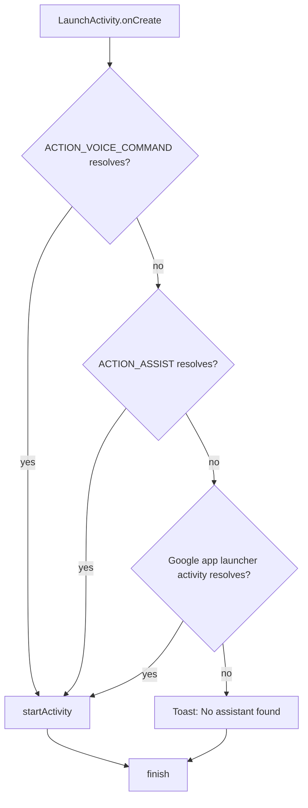

# Architecture

## Components

```
app/src/main/java/com/example/assisttap/
├── LaunchActivity.kt           # Thin entry point: resolve → start → finish
├── AssistantIntentResolver.kt  # Pure logic: first resolvable candidate wins (+ IntentResolvable)
└── IntentCandidates.kt         # Builds the ordered list of intents
```

| Component | Responsibility |
|---|---|
| `IntentCandidates` | Returns the ordered candidate intents. No Android services involved. |
| `IntentResolvable` | One-method interface: "can this intent be handled?". Lets the resolver be tested without a device. |
| `AssistantIntentResolver` | Returns the first candidate the `IntentResolvable` accepts, or `null`. |
| `LaunchActivity` | Wires `PackageManager` into the resolver, starts the result (or shows a toast) and calls `finish()`. |

## Fallback chain



## Design decisions

- **`Theme.NoDisplay` + `finish()` in `onCreate`.** No window is ever drawn, so there is no flicker. The activity is
  also `noHistory` and `excludeFromRecents`.
- **Plain `android.app.Activity`, no AndroidX at runtime.** `Theme.NoDisplay` does not work with AppCompat, and nothing
  else needs AndroidX core, so the app ships with zero runtime dependencies (the plan allowed AndroidX core; it was not
  needed).
- **Google app fallback is an explicit `MAIN`/`LAUNCHER` intent with `setPackage(...)`** instead of
  `PackageManager.getLaunchIntentForPackage()`. This keeps `IntentCandidates` free of `PackageManager` and lets the
  resolver treat all three candidates uniformly.
- **Resolution uses `Intent.resolveActivity(packageManager)`.** The manifest declares `<queries>` for both actions and
  the Google app package so this works under Android 11+ package visibility.
- **Lint `CustomSplashScreen` is suppressed** on `LaunchActivity`: it is a name-based false positive; this activity is
  not a splash screen.
- **`mipmap-anydpi-v26`** holds the adaptive icon, and lint's `ObsoleteSdkInt` is disabled: aapt2 fails to link the
  icon from an unqualified `mipmap-anydpi` folder even with `minSdk 26`.
- **Lint version-nag checks are disabled** (`OldTargetApi`, `GradleDependency`, `AndroidGradlePluginVersion`,
  `NewerVersionAvailable`): targetSdk 35 is a requirement and Dependabot handles version bumps. All other warnings are
  errors.
- **Robolectric runs against SDK 34** (`app/src/test/resources/robolectric.properties`): Robolectric's SDK 35 runtime
  requires JDK 21, while CI uses Temurin 17.
- **JUnit 5 + JUnit 4 vintage engine.** Pure tests use JUnit 5 + MockK; Robolectric tests need the JUnit 4 runner, so
  they run on the JUnit Platform through `junit-vintage-engine`.
- **Coverage gate** (`verifyResolverCoverage`) measures only `AssistantIntentResolver` and `IntentCandidates`, as the
  plan requires; `LaunchActivity` is covered by Robolectric tests but not gated.
- **AGP 9 with built-in Kotlin.** Gradle 9.6+ removed an internal API that AGP 8.x needs, so the Gradle 9 wrapper
  update required AGP 9. AGP 9 compiles Kotlin itself, so the `org.jetbrains.kotlin.android` plugin is gone and the
  Kotlin version follows AGP.
- **The coverage gate cannot pass vacuously.** It fails if it finds no classes (e.g. the compiler output path moves,
  as it did with AGP 9) or no execution data.
- **No splash build flag yet.** The plan lists it as an optional workaround for head units that block invisible apps;
  it will be added when a user reports such a unit.
