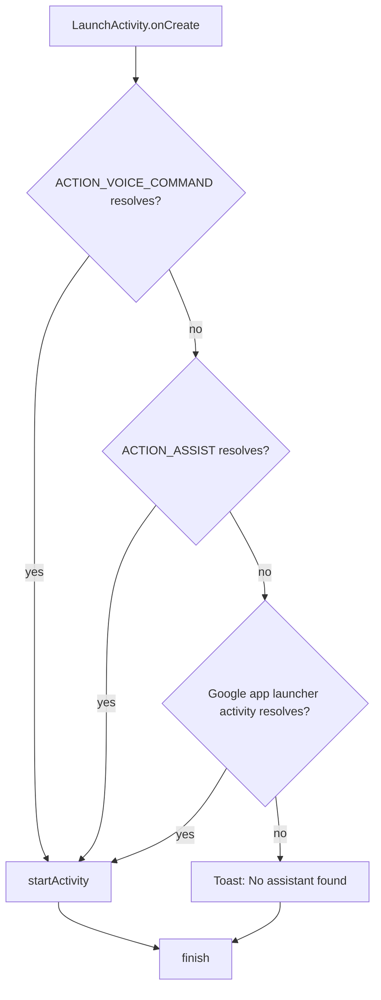
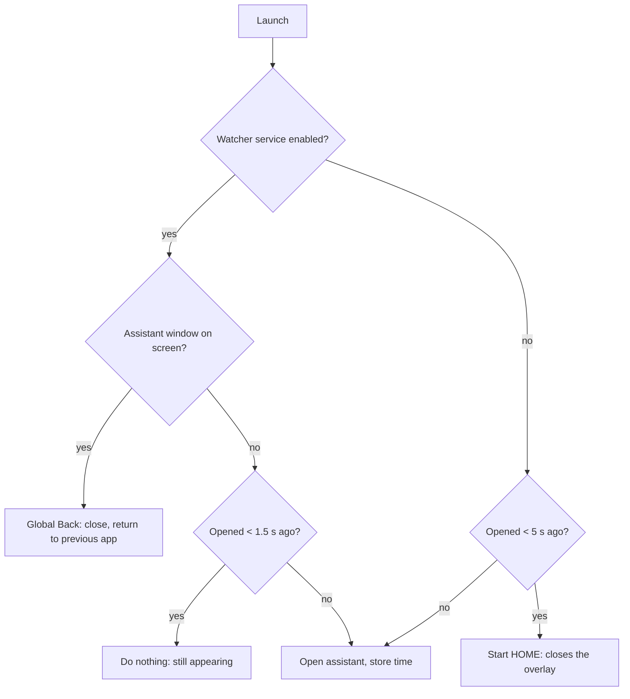

# Architecture

## Components

```
app/src/main/java/com/example/assisttap/
├── LaunchActivity.kt           # Thin entry point: resolve → start → finish
├── AssistantIntentResolver.kt  # Pure logic: first resolvable candidate wins (+ IntentResolvable)
└── IntentCandidates.kt         # Builds the ordered list of intents
```

| Component | Responsibility |
|---|---|
| `IntentCandidates` | Returns the ordered candidate intents. No Android services involved. |
| `IntentResolvable` | One-method interface: "can this intent be handled?". Lets the resolver be tested without a device. |
| `AssistantIntentResolver` | Returns the first candidate the `IntentResolvable` accepts, or `null`. |
| `AssistantToggle` | Pure time logic: "did AssistTap open the assistant within the last N ms?". |
| `AssistantWatcherService` | Optional accessibility service: tells whether the assistant's package has a window on screen and closes it with a global Back. |
| `LaunchActivity` | Wires `PackageManager` into the resolver, starts the result (or shows a toast) and calls `finish()`. |

## Fallback chain



## Press again to close



## Design decisions

- **`Theme.NoDisplay` + `finish()` in `onCreate`.** No window is ever drawn, so there is no flicker. The activity is
  also `noHistory` and `excludeFromRecents`.
- **Plain `android.app.Activity`, no AndroidX at runtime.** `Theme.NoDisplay` does not work with AppCompat, and nothing
  else needs AndroidX core, so the app ships with zero runtime dependencies (the plan allowed AndroidX core; it was not
  needed).
- **Google app fallback is an explicit `MAIN`/`LAUNCHER` intent with `setPackage(...)`** instead of
  `PackageManager.getLaunchIntentForPackage()`. This keeps `IntentCandidates` free of `PackageManager` and lets the
  resolver treat all three candidates uniformly.
- **Resolution uses `Intent.resolveActivity(packageManager)`.** The manifest declares `<queries>` for both actions and
  the Google app package so this works under Android 11+ package visibility.
- **Lint `CustomSplashScreen` is suppressed** on `LaunchActivity`: it is a name-based false positive; this activity is
  not a splash screen.
- **`mipmap-anydpi-v26`** holds the adaptive icon, and lint's `ObsoleteSdkInt` is disabled: aapt2 fails to link the
  icon from an unqualified `mipmap-anydpi` folder even with `minSdk 26`.
- **Lint version-nag checks are disabled** (`OldTargetApi`, `GradleDependency`, `AndroidGradlePluginVersion`,
  `NewerVersionAvailable`): targetSdk 35 is a requirement and Dependabot handles version bumps. All other warnings are
  errors.
- **Robolectric runs against SDK 34** (`app/src/test/resources/robolectric.properties`): Robolectric's SDK 35 runtime
  requires JDK 21, while CI uses Temurin 17.
- **JUnit 5 + JUnit 4 vintage engine.** Pure tests use JUnit 5 + MockK; Robolectric tests need the JUnit 4 runner, so
  they run on the JUnit Platform through `junit-vintage-engine`.
- **Coverage gate** (`verifyResolverCoverage`) measures only `AssistantIntentResolver` and `IntentCandidates`, as the
  plan requires; `LaunchActivity` is covered by Robolectric tests but not gated.
- **AGP 9 with built-in Kotlin.** Gradle 9.6+ removed an internal API that AGP 8.x needs, so the Gradle 9 wrapper
  update required AGP 9. AGP 9 compiles Kotlin itself, so the `org.jetbrains.kotlin.android` plugin is gone and the
  Kotlin version follows AGP.
- **The coverage gate cannot pass vacuously.** It fails if it finds no classes (e.g. the compiler output path moves,
  as it did with AGP 9) or no execution data.
- **"Press again to close" needs an accessibility service to be exact.** Measured on an Android 15 emulator: since
  Android 10, `AudioManager.getActiveRecordingConfigurations()` hides other apps' recordings (the assistant was
  recording, AssistTap saw 0), and other apps' activities and windows are invisible to normal apps. So the default is a
  time heuristic, and an opt-in accessibility service gives exact detection.
- **Closing: Back with the service, HOME without it.** Google shows the assistant either as an activity
  (`FragmentHostDefaultActivity`) or as a `VoiceInteractionSession` window. A HOME intent closes the first but not the
  second; a global Back closes both and returns to the previous app. Launching a no-UI activity closes neither.
  `ACTION_CLOSE_SYSTEM_DIALOGS` is blocked for apps targeting Android 12+.
- **Short windows: 1.5 s grace with the service, 5 s without.** v1.1.0 used 3 s and 10 s. The 3 s grace silently
  swallowed presses when the assistant failed to appear; 1.5 s only debounces a double tap. An unattended overlay
  closes itself after about 10 s (measured), and often sooner after answering, so a 10 s window sent people home when
  they meant to open it. Both are constants in `AssistantToggle`.
- **The service never reads window content.** v1.1.0 called `AccessibilityWindowInfo.getRoot()` for every window on
  each press: a synchronous IPC into every on-screen app on our main thread, which waits up to the accessibility
  timeout when an app is busy and reads as "not showing" when it returns `null`. The service now records each
  window's package from `TYPE_WINDOW_STATE_CHANGED` events and only asks system_server which window ids are live.
- **Root mode uses `cmd voiceinteraction show/hide`.** It starts a session of the active assistant directly, the path
  of a hardware assist button: 0.5 s (warm) / 0.9 s (cold) faster than `VOICE_COMMAND` on the emulator, and `hide`
  closes both assistant variants. Root is confirmed only by `uid=0` from `su -c id`, checked off the main thread (the
  root manager may prompt) and cached per install time. `dumpsys voiceinteraction` `mShown` is not used as state: it
  stayed `true` with nothing on screen. Precompiling Google (`cmd package compile -m speed`) and halving animation
  scales showed no measurable gain on the emulator, so they are not recommended.
- **`ACTION_VOICE_COMMAND` stays first.** `ACTION_ASSIST` appears faster (0.3-1.1 s vs 1.5-3.5 s on the emulator) but
  opens the Google search app instead of listening.
- **The time is `SystemClock.elapsedRealtime()` in `SharedPreferences`.** It is immune to wall-clock changes; a value
  from before a reboot is larger than "now" and is ignored.
- **No splash build flag yet.** The plan lists it as an optional workaround for head units that block invisible apps;
  it will be added when a user reports such a unit.
